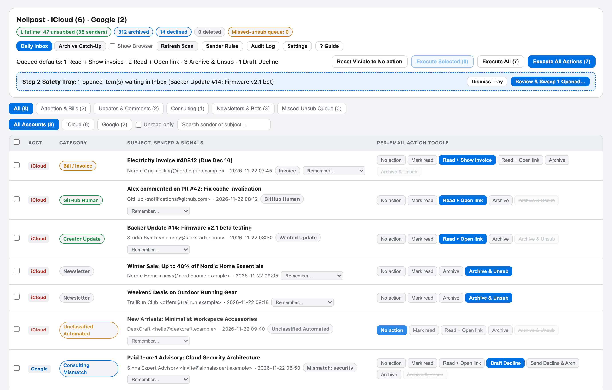
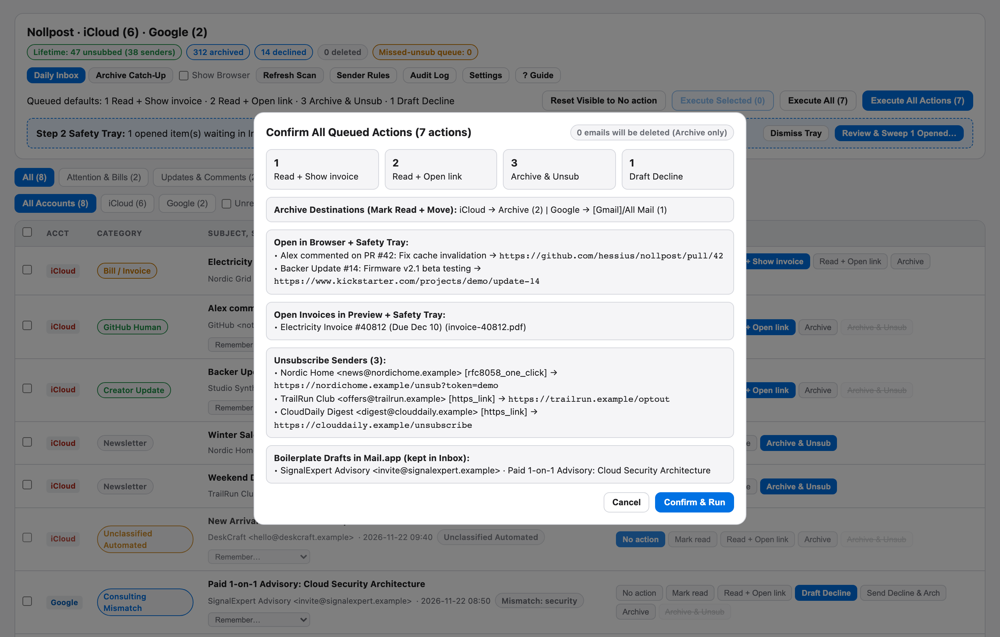
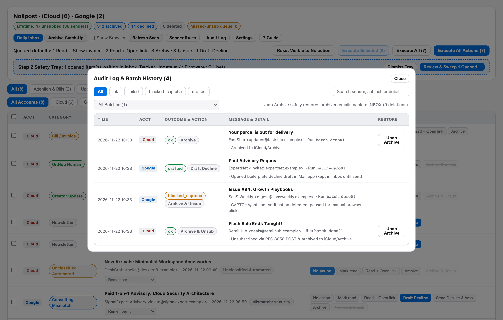

#  Nollpost

**Nollpost** (*Swedish: "zero mail"*) is a local multi-inbox triage board for **macOS Apple Mail**, featuring a strictly Archive-only workflow, deterministic RFC 8058 + Playwright unsubscribe runner, and persistent sender preference memory.

> **Safety & Privacy First:** Nollpost runs entirely on your Mac (`127.0.0.1` with an ephemeral session token), sends zero emails to external LLMs/APIs, and **never deletes emails** or leaves messages in Trash/Junk folders (see [Gmail Archiving Strategies](#gmail-archiving-strategies) and [PRIVACY.md](PRIVACY.md)).

## Screenshots

*All screenshots below use simulated demo inbox data.*



<details>
<summary>More screenshots: Confirmation Preview &amp; Audit Log with one-click Undo Archive</summary>





</details>

## Requirements

- **macOS** with **Apple Mail** configured (iCloud, Gmail, Fastmail, IMAP, etc.)
- **Python 3.12+**
- **Playwright Chromium** (`playwright install chromium`)
- macOS **Automation** permission for your terminal/Python to control `Mail.app` (`System Settings → Privacy & Security → Automation`)
- *(Optional `ui_menu` Gmail mode only)* macOS **Accessibility** permission if switching from the default `"background"` strategy to `gmail_archive_strategy = "ui_menu"` (`System Settings → Privacy & Security → Accessibility`)

## Installation

### Recommended: Homebrew (macOS Apple Silicon & Intel)

Homebrew is the **recommended** installation method: it manages the isolated Python 3.13 environment, Playwright Chromium browser binaries, and compiles the native `Nollpost.app` menu-bar launcher in one command.

```bash
brew tap hessius/tap
brew trust hessius/tap   # required once on Homebrew 7.0+
brew install hessius/tap/nollpost

# Install Nollpost.app into /Applications (menu-bar launcher) and launch it
nollpost app

# Optional first-run setup (confirms Archive folders and refreshes /Applications/Nollpost.app)
nollpost setup
```

See [docs/macos-distribution.md](docs/macos-distribution.md) for Homebrew tap release automation and update-check details.

### CLI-Only Alternatives (`uv` or `pipx`)

```bash
uv tool install git+https://github.com/Hessius/nollpost.git
# or: pipx install git+https://github.com/Hessius/nollpost.git

# Guided onboarding (installs Playwright Chromium, confirms Archive folders, writes config.toml)
nollpost setup

# Verify macOS Automation permissions and Chromium readiness
nollpost doctor
```

### From Source (Contributors)

```bash
git clone https://github.com/Hessius/nollpost.git
cd nollpost
python3 -m venv .venv
source .venv/bin/activate
pip install -e ".[dev]"
nollpost setup
```

## Quick Start

```bash
# Verify environment & Mail.app permissions
nollpost doctor

# Scan all configured Apple Mail inboxes and print a terminal summary
nollpost scan

# Launch the local Review Board web UI in your browser
nollpost serve

# Scan Archive folders for repeat newsletters to unsubscribe from
nollpost scan --mode catchup

# View lifetime triage tallies or inspect failed/missed unsubscribe snapshots
nollpost stats
nollpost missed
```

On first run, Nollpost creates `~/.config/nollpost/config.toml` where you can customize scan limits, auto-idle server shutdown (`idle_timeout_minutes = 45` by default, or `0` / `nollpost serve --idle-timeout 0` to keep running continuously), UI language (`ui_language = ""` auto-detects from your browser or supports `"en"` / `"sv"`, also configurable in **Settings**), per-account Archive folder overrides, wanted domains, and billing keywords.

## Gmail Archiving Strategies

Moving a message directly to `[Gmail]/All Mail` (or `[Gmail]/All e-post` in Swedish Gmail IMAP, shown in Apple Mail's sidebar as **Arkiv**) via Apple Mail AppleScript does not strip Gmail's `Inbox` label over IMAP. Nollpost supports four strategies under `[accounts]` in `config.toml`:

1. **`gmail_archive_strategy = "background"` (Default):** Runs completely in the background with zero Mail windows, zero focus stealing, no Accessibility permission, and no Google Apps Script. Each message with an RFC `Message-ID` is moved briefly to `[Gmail]/Trash` (localized, e.g. `[Gmail]/Papperskorgen`, which triggers Gmail to strip `\Inbox`) and immediately relocated by `Message-ID` into `[Gmail]/All Mail` (or `[Gmail]/All e-post`), rolling back to `INBOX` if relocation fails.
2. **`gmail_archive_strategy = "ui_menu"`:** Opens the target message in Apple Mail and clicks Mail's native **Archive** (`Arkivera`) toolbar button (with validated **Message -> Archive** menu fallback), verifying that only the target message left `INBOX`. Requires macOS **Accessibility** permission.
3. **`gmail_archive_strategy = "two_hop"`:** Legacy option staging messages through `_ArchiveTmp` before moving to All Mail.
4. **`gmail_archive_strategy = "tag_staging"`:** Moves messages to `_ArchiveTmp` for a user-installed Google Apps Script trigger on your own Google account.

<details>
<summary>Optional: Setting up Google Apps Script for <code>tag_staging</code></summary>

1. Open [script.google.com](https://script.google.com) on your Google account and create a **New project**.
2. Paste the following script:

```javascript
function archiveLabeledEmails() {
  var labelName = '_ArchiveTmp'; // Replace with your exact label name
  var label = GmailApp.getUserLabelByName(labelName);

  if (!label) return; // Stops safely if the label name isn't found

  var threads = GmailApp.search('in:inbox label:' + labelName);

  for (var i = 0; i < threads.length; i++) {
    threads[i].moveToArchive();
    threads[i].removeLabel(label);
  }
}
```

3. Click **Run** once to grant the script permission to manage your Gmail threads.
4. Open **Triggers** (clock icon) → **Add Trigger** → run `archiveLabeledEmails` on a **Time-driven** schedule (e.g., every 5 minutes).
5. Set `gmail_archive_strategy = "tag_staging"` under `[accounts]` in `config.toml`.

</details>

## License & Notices

- Licensed under the [MIT License](LICENSE).
- Third-party notices and acknowledgements are listed in [THIRD_PARTY_NOTICES.md](THIRD_PARTY_NOTICES.md).
